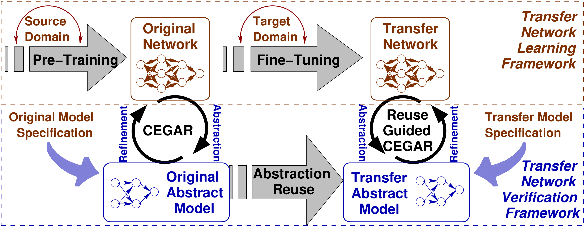

# Abstract Reuse for Neural Network Verification
<p align="center">
  
</p>

This project implements an abstract-reuse workflow for verifying transferred neural networks. The main working directory is `abstract_reuse`, and the main executable script is `abstract_reuse/transfer_abstract.py`.

The workflow uses the existing `CEGAR_NN` abstraction/refinement framework together with Marabou through `maraboupy`.

## Project Layout

```text
.
├── abstract_reuse/
│   ├── transfer_abstract.py        # Main script to run the transfer abstraction workflow
│   ├── transfer_logging.py         # CSV logging utilities
│   ├── transferred_networks/       # Saved intermediate/final network artifacts
│   └── *.py / logging docs         # Helper scripts and logging documentation
├── CEGAR_NN/                       # CEGAR-NN framework used for abstraction/refinement
├── Marabou/                        # Marabou framework
├── nnet/                           # Original ACAS Xu .nnet models
├── sample_result.csv/              # Sample result for a network
├── conda_marabou_py3.8.yml         # Conda environment export
└── INSTALLATION.md                 # Installation guide to install required packages
```

## Environment

This project is known to run successfully in the conda environment:

An exported conda environment file is included as `conda_marabou_py3.8.yml`.

Create the environment with command

```bash
conda env create -f conda_marabou_py3.8.yml
```
Then activate the environment

```bash
conda activate marabou_py3.8
```

The environment should provide Python 3.8 and the required Python packages, including:

- `maraboupy`
- `numpy`
- `pandas`
- `networkx`
- `matplotlib`


For full setup instructions, see `INSTALLATION.md`.

## How to Execute the tool

Run the main script from the project root directory:

```bash
python3 abstract_reuse/transfer_abstract.py
```

By default, this runs network `1_1`, property `property_1`, alpha `0.05`, and writes logs to `sample_result.csv`.

In `sample_result.csv` file, it logs all the necessary informations like Total verification time of original netowrk and transfer network using CEGAR-NN (`from scratch verification`) and number of refinemnts needed and individual times of each refinement, time to transfer the abstract (`ABSTRACT REUSE` time) and verification time of transfer network using `ABSTRACT REUSE`.

varry `alpha`, `strategy`, `layer` to generate  results for different transfered networks for the same benchmark network. The average times were reported in paper. 

Example with explicit parameters:

```bash
python abstract_reuse/transfer_abstract.py \
  -nn 1_6 \
  -pid property_1 \
  -alpha 0.05 \
  -strategy random-discrete \
  -max_refine 10 \
  -layer 10 \
  -log results_new/transfer_execution_log_1.csv

```
Descriptions of each parameters are given below.

The `-nn` option can be an ACAS Xu network identifier such as `1_1`. The script resolves it to:

```text
nnet/ACASXU_run2a_1_1_batch_2000.nnet
```

You can also pass a direct path to a `.nnet` file.


## Main Workflow

`abstract_reuse/transfer_abstract.py` performs the following steps:

1. Creates a transferred network by perturbing edge weights using the selected alpha and strategy.
2. Verifies the original/source network with CEGAR-NN and obtains an abstract network.
3. Reuses the source abstraction to create an abstract transfer network.
4. Verifies the abstract transfer network with refinement.
5. Verifies the transferred network from scratch using CEGAR-NN for comparison.

## Common Command-Line Options

```text
-nn, --nnet_file              ACAS Xu network ID, for example 1_6, or a path to a .nnet file
-pid, --property_id           Property ID to verify, for example property_1
-alpha, --alpha               Weight perturbation amount
-strategy                     Perturbation strategy: random, worst_case, best_case, random-discrete
-r, --results_dir             CEGAR-NN experiment result directory
-o, --output_dir              Directory for saved network artifacts
-max_refine                   Maximum refinement steps in transfer-abstract verification
-log, --log_csv               CSV file path for execution metrics
-layer, --last_layers         Number of last layers changed in the transfer network
-v, --verbose                 Enable verbose error output
```

## Outputs

Typical outputs include:

- Transferred `.nnet` files in `transfer_network/`
- Pickled intermediate networks in `abstract_reuse/transferred_networks/`
- Metadata and node mappings in `abstract_reuse/transferred_networks/`
- CSV execution logs in `results_new/` or the path passed with `-log`
- CEGAR-NN experiment artifacts in `CEGAR_NN/experiments/dev_exp_results_archive/`

## Notes

- Run commands from the project root so relative paths resolve correctly.
- `CEGAR_NN` and `Marabou` are required project components and should remain in the repository root.
- Some verification runs may take several minutes or longer depending on the selected network, property, alpha value, and refinement settings.
